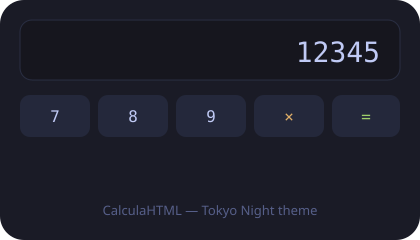

# CalculaHTML

A feature-rich, visually rich modern HTML calculator with multiple themes.



## Features

- Basic arithmetic: `+ − × ÷`, percentages, sign toggle, backspace
- Scientific functions: `sin cos tan log ln √ x² x³ x^y 1/x n!`, constants `π` and `e`
- Memory: `MC MR M+ M− MS`
- History tape with up to 40 entries
- 14 themes: Dark, Light, Gruvbox, Everforest, Tokyo Night, Dracula, Nord, Catppuccin Mocha, One Dark, Solarized Dark, Rose Pine, Monokai, GitHub Dark, Old Dark
- Keyboard support, copy result, angle mode (DEG/RAD)
- Responsive layout, accessible, reduced-motion friendly
- Zero dependencies — pure HTML/CSS/JS

## Usage

Open `index.html` in any modern browser. No build step required.

```bash
git clone https://github.com/Mark44928/CalculaHTML.git
cd CalculaHTML
# open index.html
```

## Themes

Switch themes from the dropdown in the top bar. Choice is persisted in `localStorage`.

## Keyboard shortcuts

| Key | Action |
|---|---|
| `0-9`, `.` | input |
| `+ - * / ^` | operators |
| `Enter` / `=` | evaluate |
| `Backspace` | delete |
| `Esc` | clear all |
| `Delete` | clear entry |
| `%` | percent |

## Project structure

```
CalculaHTML/
├── index.html
├── css/styles.css
├── js/app.js
├── assets/
├── README.md
├── AGENTS.md
├── LICENSE
└── .github/workflows/pages.yml
```

## License

MIT
