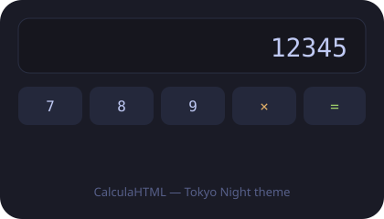

# CalculaHTML

<p align="center">
  <a href="https://mark44928.github.io/CalculaHTML/"></a>
</p>

<p align="center">
  
  <a href="https://github.com/Mark44928/CalculaHTML/actions/workflows/ci.yml"></a>
  
  
  
</p>

A feature-rich, responsive calculator that runs entirely in the browser: 15 themes plus a System (auto) mode, scientific functions, memory, a history tape, keyboard support, and offline PWA support.

**Live demo:** https://mark44928.github.io/CalculaHTML/

## Features

- Basic arithmetic: `+ − × ÷`, percentages, sign toggle, backspace
- Scientific functions: `sin cos tan log ln √ x² x³ x^y 1/x n!`, constants `π` and `e`
- Memory: `MC MR M+ M− MS`
- History tape with up to 100 entries — copy it, or **download it as CSV**
  (proper RFC 4180 quoting) for spreadsheets and record keeping
- 15 themes + System (auto light/dark): Dark, Light, Gruvbox, Everforest, Tokyo Night, Dracula, Nord, Catppuccin Mocha, One Dark, Solarized Dark, Rose Pine, Monokai, GitHub Dark, Old Dark, Greenit
- Keyboard support, copy result, angle mode (DEG/RAD)
- **Keyboard shortcut overlay** — press <kbd>?</kbd> any time to see every
  shortcut (operators, scientific keys, percent semantics, Esc to close)
- Responsive layout, accessible controls, reduced-motion friendly
- Progressive Web App: installable, offline-capable (manifest + service worker)
- No frameworks and no build step. Google Fonts load when online and fall back to system fonts offline.
- v1.1.0 also fixes: `%` now means "percent **of the pending operand**" for
  `+`/`−` (200+10% = 220), undo/redo restore the history tape, the service
  worker precaches only what the page actually fetches **and** serves the
  cached shell when offline (launching the installed app offline no longer
  falls back to offline.html), the CSV download keeps its blob URL alive
  long enough for the browser to pick it up (immediate revoke aborted the
  download in Firefox), and CI runs
  `make check` (inline CSS **and** JS sync) plus the CSV unit tests.

## Install as an app (PWA)

1. Open the [live demo](https://mark44928.github.io/CalculaHTML/) in Chrome, Edge, or Safari.
2. Use **Install app** / **Add to Home Screen**.
3. Launch it like a native app. The service worker caches the app shell so it keeps working offline.

## Usage

### Live

Open https://mark44928.github.io/CalculaHTML/ — nothing to install.

### Local

```bash
git clone https://github.com/Mark44928/CalculaHTML.git
cd CalculaHTML
python3 -m http.server 8080
# open http://localhost:8080
```

Opening `index.html` directly also works, but a local server enables the service worker and PWA install.

## Themes

Switch themes from the dropdown or the color swatches. The choice is saved in `localStorage`. **System** follows your OS light/dark preference.

## Keyboard shortcuts

| Key | Action |
|---|---|
| `0-9`, `.` | input |
| `+ - * / ^` | operators |
| `Enter` / `=` | evaluate |
| `Backspace` | delete |
| `Esc` | clear all |
| `Delete` | clear entry |
| `%` | percent |

## Project structure

```
CalculaHTML/
├── index.html
├── css/styles.css
├── js/app.js
├── assets/
│   ├── icon.svg
│   ├── icon-192.png / icon-512.png
│   ├── maskable-192.png / maskable-512.png
│   ├── apple-touch-icon.png
│   ├── favicon-32.png
│   └── preview.svg
├── offline.html
├── manifest.webmanifest
├── sw.js
├── package.json
├── README.md
├── AGENTS.md
├── LICENSE
├── Makefile
└── .github/workflows/
    ├── ci.yml
    └── pages.yml
```

## Development

No dependencies to install.

```bash
npm run check        # node --check js/app.js
make check           # node --check + manifest + CSS sync verification
make sync-size       # sync css/styles.css into index.html inline <style>
make start           # python3 -m http.server 8080
```

CI runs the JavaScript syntax check and validates `manifest.webmanifest` on every push and pull request.

## Browser support

Recent Chrome, Edge, Firefox, and Safari. The layout uses `color-mix()` and modern CSS, so older browsers may not render every theme effect correctly. PWA install depends on the browser.

## Contributing

Issues and pull requests are welcome — see [CONTRIBUTING.md](CONTRIBUTING.md).
Keep the project framework-free and dependency-free; this project follows the
standard [Code of Conduct](CODE_OF_CONDUCT.md).


## 🛠️ More from Mark44928

Tiny, dependency-free tools from the same family:

- [plusafetch](https://github.com/Mark44928/plusafetch) — C++23 fetch for Termux — ~23 ms, zero subprocesses on the default path
- [Plusalator](https://github.com/Mark44928/Plusalator) — C++17 calculator REPL — Qalculate-flavored, ghost autosuggest, 18 themes
- [GrubBlastersHTML](https://github.com/Mark44928/GrubBlastersHTML) — Worms-style artillery in one HTML file — 70 weapons, fully destructible terrain
- [SnakTUI](https://github.com/Mark44928/SnakTUI) — modern Snake for your terminal — Textual + Python
- [Easy-Termux-Package-Manager](https://github.com/Mark44928/Easy-Termux-Package-Manager) — fzf-driven package manager for Termux — snapshots, audit, 183 tests
- [NoNameOS](https://github.com/Mark44928/NoNameOS) — OS simulation in a single C++17 file — virtual FS, real shell
- [Greenit](https://github.com/Mark44928/Greenit) — green-injected theme family — dark + light, single palette.json
- [android12-fastfetch](https://github.com/Mark44928/android12-fastfetch) — fastfetch config for Android 12 + native X11 Termux desktops
- [Anti-bloatware-list-for-Android-TV-Boxes-and-Sticks-for-rooted](https://github.com/Mark44928/Anti-bloatware-list-for-Android-TV-Boxes-and-Sticks-for-rooted) — ADB debloat for rooted Android 9+ TV sticks & boxes
- [Android9-audios](https://github.com/Mark44928/Android9-audios) — 217 stock Android 9 system sounds + per-file SHA-256

## License

MIT — see [LICENSE](LICENSE).
