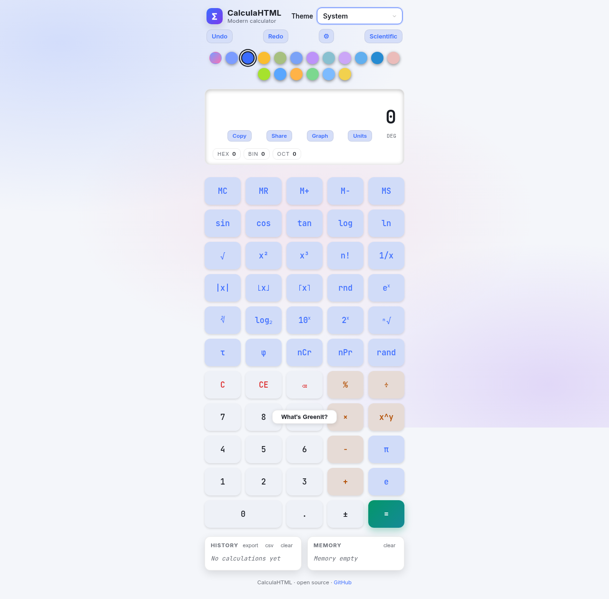

# CalculaHTML

<p align="center"></p>

<p align="center">
  <a href="https://mark44928.github.io/CalculaHTML/"></a>
</p>

<p align="center">
  
  <a href="https://github.com/Mark44928/CalculaHTML/actions/workflows/ci.yml"></a>
  
  
  
</p>

A responsive calculator that runs entirely in the browser: 17 themes plus a System (auto) mode, scientific functions, memory, a history tape, keyboard support, and offline PWA support.

**Live demo:** https://mark44928.github.io/CalculaHTML/

## Features

- Basic arithmetic: `+ − × ÷`, percentages, sign toggle, backspace
- Scientific functions: `sin cos tan log ln √ x² x³ x^y 1/x n!`, constants `π` and `e`
- Memory: `MC MR M+ M− MS`
- History tape with up to 100 entries — copy it, or **download it as CSV**
  (proper RFC 4180 quoting) for spreadsheets and record keeping
- **Keyboard history recall** — press `↑` / `↓` to step through previous
  expressions without leaving the keypad; typing resumes your draft
- **Share links** — copy a URL that restores the latest calculation and result
  when opened (expression and value live in the URL fragment, no backend)
- 17 themes + System (auto light/dark): Dark, Light, Gruvbox, Everforest, Tokyo Night, Dracula, Nord, Catppuccin Mocha, One Dark, Solarized Dark, Rose Pine, Monokai, GitHub Dark, Old Dark, Greenit, Bluney, Yellen
- Keyboard support, copy result, angle mode (DEG/RAD)
- **Function graph** — press <kbd>G</kbd> for a canvas plot of `y = f(x)`:
  `x`, `+ − * / ^`, `sin cos tan ln log log2 sqrt abs exp` and constants
  `pi tau phi e`, implicit multiplication (`2x`, `3sin(x)`), custom x-range,
  live redraw, a self-contained parser (no `eval`), one-tap **PNG export**
  of the current plot, reusable **graph presets** — built-in trig,
  polynomial, exponential and reciprocal curves, plus save/delete your own
  ranges and formulas locally — and an optional `t` parameter with a slider
  and **Play t** animation, plus an **Estimate area** toggle that approximates
  ∫ f₁(x) dx over the current x-range (Simpson's rule, first curve only)
- **Unit converter** — press <kbd>U</kbd> for length, mass, temperature, data,
  speed, time, volume, area and energy conversions, with swap and copy result
- **Keyboard shortcut overlay** — press <kbd>?</kbd> any time to see every
  shortcut (operators, scientific keys, percent semantics, Esc to close)
- Responsive layout, accessible controls, reduced-motion friendly
- Progressive Web App: installable, offline-capable (manifest + service worker)
- No frameworks and no build step. Google Fonts load when online and fall back to system fonts offline.
- v1.1.0 also fixes: `%` now means "percent **of the pending operand**" for
  `+`/`−` (200+10% = 220), undo/redo restore the history tape, the service
  worker precaches only what the page actually fetches **and** serves the
  cached shell when offline (launching the installed app offline no longer
  falls back to offline.html), the CSV download keeps its blob URL alive
  long enough for the browser to pick it up (immediate revoke aborted the
  download in Firefox), and CI runs
  `make check` (inline CSS **and** JS sync) plus the CSV unit tests.
- v1.2.0 adds **keyboard history recall**: `↑` steps back through previous
  expressions, `↓` returns toward the draft, and any fresh input clears the
  recall cursor. The pure navigation rule is covered by `tests/test_logic.mjs`.
- v1.3.0 adds the **Unit converter**: 9 categories, temperature-aware
  conversions, swap, copy, an automatic current-result seed and 16 unit tests.
- v1.4.0 adds **graph presets**: built-in curve sets, save/load/delete for up to
  12 custom formulas and x-ranges, stored in `localStorage`, with dedicated
  preset tests alongside the graph parser suite.
- v1.5.0 adds **animated graphs**: expressions can use `t`, a slider selects the
  value, and **Play t** animates it without adding another parser or dependency.
- v1.8.0 adds the **Yellen** gold theme and refreshes the service-worker shell.
- v1.9.0 persists the calculation history across reloads (last 100 entries,
  filtered against corrupt storage) so the tape survives closing the app.
- v1.6.0 adds the graph **Estimate area** toggle: a 1000-panel Simpson's-rule
  estimate of ∫ f₁(x) dx over the current x-range (first curve only, even with
  overlays plotted), shown in the status line; invalid, empty, non-finite or
  too-wide cases show an error instead of crashing. One new Simpson self-check,
  98 checks in total.

## Install as an app (PWA)

1. Open the [live demo](https://mark44928.github.io/CalculaHTML/) in Chrome, Edge, or Safari.
2. Use **Install app** / **Add to Home Screen**.
3. Launch it like a native app. The service worker caches the app shell so it keeps working offline.

## Usage

### Live

Open https://mark44928.github.io/CalculaHTML/ — nothing to install.

### Local

```bash
git clone https://github.com/Mark44928/CalculaHTML.git
cd CalculaHTML
python3 -m http.server 8080
# open http://localhost:8080
```

Opening `index.html` directly also works, but a local server enables the service worker and PWA install.

## Themes

Switch themes from the dropdown or the color swatches. The choice is saved in `localStorage`. **System** follows your OS light/dark preference.

## Keyboard shortcuts

| Key | Action |
|---|---|
| `0-9`, `.` | input |
| `+ - * / ^` | operators |
| `Enter` / `=` | evaluate |
| `↑` / `↓` | recall previous / next expression from history |
| `Backspace` | delete |
| `Esc` | clear all |
| `Delete` | clear entry |
| `%` | percent |
| `S` `C` `T` | sin / cos / tan |
| `L` `R` `Q` `I` `F` | ln / √ / x² / 1÷x / n! |
| `P` | π |
| `G` | graph `y = f(x)` (self-contained parser) |
| `U` | unit converter |

## Project structure

```
CalculaHTML/
├── index.html
├── css/styles.css
├── js/app.js
├── assets/
│   ├── icon.svg
│   ├── icon-192.png / icon-512.png
│   ├── maskable-192.png / maskable-512.png
│   ├── apple-touch-icon.png
│   ├── favicon-32.png
│   └── preview.svg
├── offline.html
├── manifest.webmanifest
├── sw.js
├── package.json
├── README.md
├── AGENTS.md
├── LICENSE
├── Makefile
└── .github/workflows/
    ├── ci.yml
    └── pages.yml
```

## Development

No dependencies to install.

```bash
npm run check        # node --check js/app.js
make check           # node --check + manifest + CSS sync verification
make sync-size       # sync css/styles.css into index.html inline <style>
make start           # python3 -m http.server 8080
```

CI runs the JavaScript syntax check and validates `manifest.webmanifest` on every push and pull request.

## Browser support

Recent Chrome, Edge, Firefox, and Safari. The layout uses `color-mix()` and modern CSS, so older browsers may not render every theme effect correctly. PWA install depends on the browser.

## Contributing

Issues and pull requests are welcome — see [CONTRIBUTING.md](CONTRIBUTING.md).
Keep the project framework-free and dependency-free; this project follows the
standard [Code of Conduct](CODE_OF_CONDUCT.md).


## 🛠️ More from Mark44928

Tiny, dependency-free tools from the same family:

- [Pythonator](https://github.com/Mark44928/Pythonator) — Python rewrite of Plusalator — stdlib-only, `--eval`/`--json`
- [Solvamath](https://github.com/Mark44928/Solvamath) — terminal math puzzle game — seven puzzle types, daily seed, achievements
- [Bluney](https://github.com/Mark44928/Bluney) — blue-injected theme family — dark + light, single palette.json
- [Fluffless Prompt](https://github.com/Mark44928/FlufflessPrompt) — quiet Oh My Zsh theme — Git state, exit codes, clock
- [Weatui](https://github.com/Mark44928/Weatui) — friendly Open-Meteo weather TUI — saved cities, forecasts, no API key
- [Yellen](https://github.com/Mark44928/Yellen) — golden-yellow theme family — dark + light, single palette.json
- [Mark44928](https://github.com/Mark44928) — profile and project index
- [plusafetch](https://github.com/Mark44928/plusafetch) — C++23 fetch for Termux — ~23 ms, zero subprocesses on the default path
- [Plusalator](https://github.com/Mark44928/Plusalator) — C++17 calculator REPL — Qalculate-flavored, ghost autosuggest, 19 themes
- [GrubBlastersHTML](https://github.com/Mark44928/GrubBlastersHTML) — Turn-based artillery in one HTML file — 73 weapons, fully destructible terrain
- [SnakTUI](https://github.com/Mark44928/SnakTUI) — Snake game for the terminal — Textual + Python
- [Easy-Termux-Package-Manager](https://github.com/Mark44928/Easy-Termux-Package-Manager) — fzf-driven package manager for Termux — snapshots, audit, 194 tests
- [NoNameOS](https://github.com/Mark44928/NoNameOS) — OS simulation in a single C++17 file — virtual FS, real shell
- [Greenit](https://github.com/Mark44928/Greenit) — green-injected theme family — dark + light, single palette.json
- [android12-fastfetch](https://github.com/Mark44928/android12-fastfetch) — fastfetch config for Android 12 + native X11 Termux desktops
- [debloat-android-tv](https://github.com/Mark44928/debloat-android-tv) — ADB debloat for rooted Android 9+ TV sticks & boxes
- [Android9-audios](https://github.com/Mark44928/Android9-audios) — 217 stock Android 9 system sounds + per-file SHA-256

## License

MIT — see [LICENSE](LICENSE).

---

<div align="center">

</div>

---

**More projects:** [Mark44928's hub](https://mark44928.github.io/Mark44928/) — a family of dependency-free tools for Termux, Linux, and the terminal.
